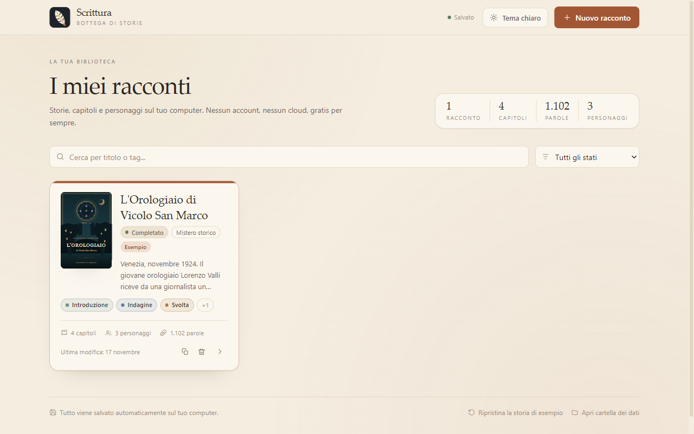
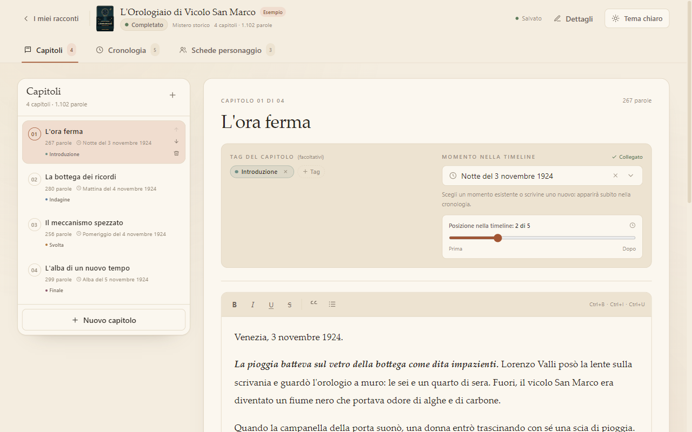
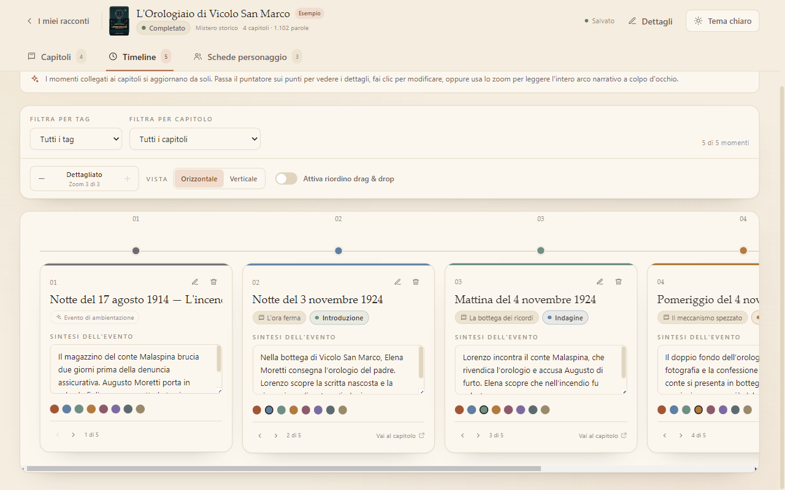
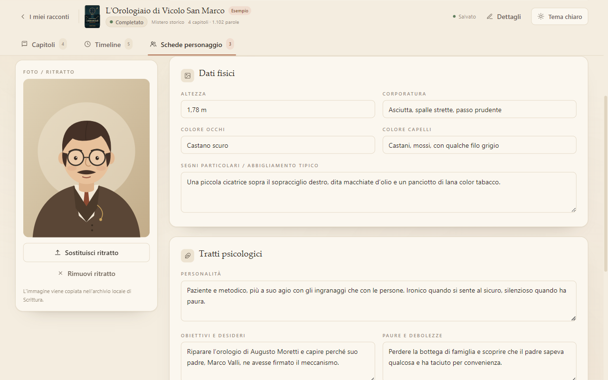

# Scrittura

**Scrittura** è una bottega digitale per chi scrive storie. Un luogo tranquillo in cui raccogliere i
tuoi racconti, dare un volto ai personaggi e seguire la trama momento per momento, senza distrazioni
e senza dover caricare nulla online.

Tutto ciò che scrivi resta sul tuo computer. Non servono account, non ci sono pubblicità e nessuna
storia lascia la tua scrivania.

**Scarica l'installer per Windows: [Scrittura-Setup-1.0.3.exe](Scrittura-Setup-1.0.3.exe)**

L'installer è incluso nella cartella principale del progetto. Puoi scaricarlo anche dalla
[pagina delle release](https://github.com/sergiobrancato/scrittura/releases/latest).

## Installazione su Windows

1. Apri **Scrittura-Setup-1.0.3.exe** dalla cartella principale di Scrittura (oppure scaricalo dal
   link qui sopra).
2. Fai doppio clic sul file.
3. Segui le indicazioni dell'installazione. Al termine troverai l'icona di Scrittura sul Desktop.
4. Fai doppio clic sull'icona del Desktop per aprire l'app.

## I miei racconti

La biblioteca è il punto di partenza. Ogni racconto ha la sua scheda con il titolo, il genere, lo
stato di lavorazione, una breve sinossi, il numero di capitoli e personaggi, il conteggio delle
parole e la data dell'ultima modifica.

Da qui puoi:

- creare un nuovo racconto;
- cercare una storia per titolo o per tag;
- filtrare per stato — *Bozza*, *In corso*, *In revisione* o *Completato*;
- duplicare un racconto per provare una nuova versione;
- eliminare una storia, con una conferma prima di procedere.

## Scrivere i capitoli

L'area di scrittura è semplice e immediata. Ogni capitolo ha il suo titolo, il suo testo e i suoi tag.

La barra di formattazione ti permette di dare ritmo alla pagina con:

- **Grassetto** (`Ctrl+B` / `Cmd+B`)
- **Corsivo** (`Ctrl+I` / `Cmd+I`)
- **Sottolineato** (`Ctrl+U` / `Cmd+U`)
- **Barrato**
- **Citazione**
- **Elenco puntato**

Il conteggio delle parole resta preciso anche quando usi la formattazione. I tuoi capitoli precedenti
continuano ad aprirsi esattamente come li avevi lasciati.

*L'editor dei capitoli: formattazione, tag facoltativi e posizione nella timeline.*

### Tag facoltativi

Puoi aggiungere ai capitoli tag come *Bozza*, *Da rivedere*, *Colpo di scena* o inventarne di nuovi,
scegliendo un colore per ciascuno. I tag servono a ritrovare le scene e a filtrare la timeline.

### Il momento nella timeline

Ogni capitolo può essere collegato a un momento della storia, per esempio *Notte del 3 novembre
1924*. Puoi scegliere un momento già esistente o scriverne uno nuovo.

Quando un capitolo è collegato, sotto il campo compare un cursore: **Posizione nella timeline**.
Trascinalo per spostare il capitolo prima o dopo nella timeline; la nuova posizione viene applicata
subito.

## La timeline

La timeline racconta la forma della storia. Puoi guardarla **in orizzontale** o **in verticale**,
scegliendo la vista che preferisci dal comando dedicato.

*La timeline orizzontale: momenti collegati, punti colorati e tre livelli di zoom.*

Ci sono tre livelli di zoom:

1. **Dettagliato**: schede complete con il momento, il capitolo collegato, i tag e la sintesi
   dell'evento.
2. **Compatto**: i punti sulla linea con il titolo del capitolo o dell'evento.
3. **Panoramica**: solo i punti, per abbracciare l'intero arco narrativo con un solo sguardo.

Passando il puntatore sui punti delle viste più compatte compare un riepilogo con il titolo del
capitolo, il momento e i tag. Un clic apre la **modifica rapida**, dove puoi cambiare il momento, il
titolo del capitolo collegato e la sintesi dell'evento, oppure saltare direttamente al capitolo.

Nella timeline puoi anche:

- aggiungere eventi di ambientazione non legati a un capitolo, come antefatti o avvenimenti del
  mondo;
- filtrare i momenti per tag o per capitolo;
- cambiare il colore dei punti;
- attivare **Attiva riordino drag & drop** e trascinare i momenti per cambiarne l'ordine;
- spostare lo sguardo trascinando lo sfondo della linea del tempo.

Tutto viene salvato automaticamente.

## Schede personaggio

Ogni personaggio ha una scheda completa, con un ritratto e tutto ciò che serve per conoscerlo davvero.

*Le schede personaggio: ritratto, dati fisici e tratti psicologici.*

- **Informazioni generali**: nome, ruolo ed età.
- **Foto / Ritratto**: carica un'immagine dal tuo computer; Scrittura la conserva nella propria
  raccolta. Se non ne scegli una, compare un segnaposto con le iniziali del personaggio.
- **Dati fisici**: altezza, corporatura, occhi, capelli, segni particolari e abbigliamento tipico.
- **Tratti psicologici**: personalità, obiettivi e desideri, paure e debolezze, conflitto interiore,
  note aggiuntive.
- **Capitoli collegati**: scegli i capitoli in cui il personaggio compare.

## Tema chiaro e tema scuro

Scegli l'atmosfera che preferisci dalla barra in alto: **Tema chiaro** per la carta calda di giorno,
**Tema scuro** per le ore di scrittura più silenziose. La scelta viene ricordata.

## La storia di esempio

Al primo avvio trovi **L'Orologiaio di Vicolo San Marco**, un racconto completo ambientato a Venezia
nel 1924, con capitoli, personaggi e una timeline già pronti da esplorare. È il modo più semplice
per vedere Scrittura in azione.

Se elimini la storia di esempio, puoi farla tornare in qualsiasi momento da **Ripristina storia di
esempio** nella biblioteca.

## Consigli per iniziare

1. Apri la storia di esempio e sfoglia i capitoli.
2. Passa alla timeline e prova i tre livelli di zoom.
3. Apri una scheda personaggio e guarda come convivono ritratto, dettagli e conflitti interiori.
4. Torna alla biblioteca, duplica la storia di esempio e prova a cambiare copertina e colore.
5. Quando sei pronto, crea il tuo primo racconto.

Buona scrittura.

